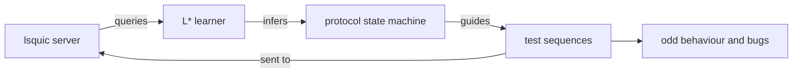

# Hi, I'm Arpan Shingala 👋

🛠️ I build tools that poke at network protocols until they misbehave.

Right now that means an MSc in Computer Science at KIT in Karlsruhe, with a focus on IT security and cryptography. Before that: nearly two years of backend and systems work, and a DRDO-sponsored research project where a fuzzer I built found unknown behaviour in a QUIC library that its docs never mention.

🎯 **Looking for:** HiWi or research assistant positions, and Werkstudent roles in backend or security engineering around Karlsruhe.

---

## 🔬 The project I enjoy explaining

QUIC is hard to fuzz blindly because most of the interesting bugs sit deep in the protocol's state machine. Random packets rarely get there. So I let the fuzzer learn the state machine first.

*A sketch of the idea, not the exact architecture.*

I built this as undergraduate research at DA-IICT (Jan 2024 to Apr 2024). The learner uses the L* algorithm, with a modified quic-scapy to speak gQUIC 43. Two results came out of it:

- 🐞 It detected a known critical vulnerability, so I knew the approach could find real bugs.
- 🔍 It showed behaviour in lsquic that the library does not document.

Stack: Python, quic-scapy, Wireshark. The earlier part of the project (Jan 2023 to May 2023) was a comparison of methods for analysing QUIC implementations, followed by bug-detection techniques I proposed and validated.

---

## 🦀 Open source I wrote

### [rust-lstar](https://github.com/arpan-vs/rust-lstar)

A Rust implementation of Angluin's L* algorithm, published on crates.io. It learns Mealy-style automata from a system by asking it questions, and it has the pieces you need to run that against something real:

- Several equivalence-test strategies: W-method, Wp-method, random walk and a distance-based one, which can be combined
- A TCP-based knowledge base, so the learner can query a remote target
- DOT import and export for the learned automata
- Examples built around a vending machine, a coffee server and an ATM

---

## 💼 Work so far

| When | Where | What I did |
|---|---|---|
| Nov 2025 to Aug 2026 | Silicon Bits | Took a laser-based distance measurement system from 3 to 30 FPS using centroid detection, triangulation and better use of the hardware. Refined image-processing models that find logos and read invoice fields, served through an API and a UI. Programmed PLCs for an industrial client. |
| Jan 2025 to Oct 2025 | Freelance | Built a trading platform with authentication, encryption, real-time monitoring and protection against common attacks. FastAPI, Express.js, React, Next.js. |
| Oct 2024 to Dec 2024 | Asquare Tech Lab | Raised the accuracy of a Punjabi speech-to-text model by 32% by feeding new data into the subtitle workflow in real time. Fine-tuned OpenAI Whisper offline. |
| May 2023 to Jul 2023 | Simform | Tested two internal web apps against the OWASP Top 10 with Nmap, Acunetix, Retire.js and Shodan. |

---

## 🧰 Toolbox

| Area | What I use |
|---|---|
| Languages | Python, Rust, TypeScript, C, C++, JavaScript |
| Web | React, Next.js, FastAPI, Express.js |
| Data and cloud | PostgreSQL, SQL, AWS (Lambda, S3, IAM) |
| Security and networking | Wireshark, Nmap, Acunetix, Retire.js, Shodan, quic-scapy |
| ML and data | TensorFlow, Pandas, NumPy, Matplotlib, OpenAI Whisper |

---

## 🌱 Currently

- 🎓 Studying IT security and cryptography at KIT, with security research as the longer-term direction. AI and blockchain are on the list too.
- 🇩🇪 Learning German, currently at A1.

## 📬 Get in touch

📧 Email: [av.shingala02@outlook.com](mailto:av.shingala02@outlook.com)
